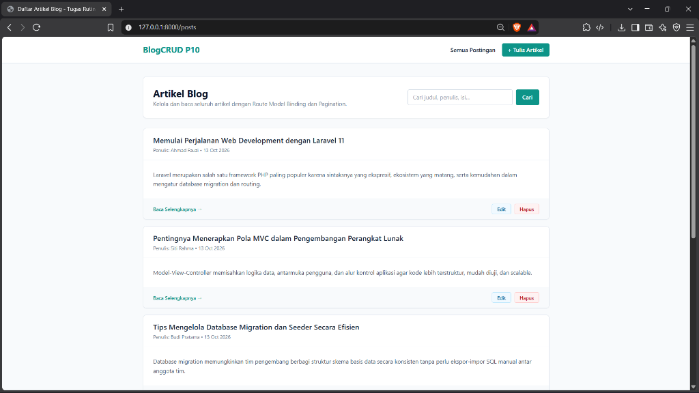
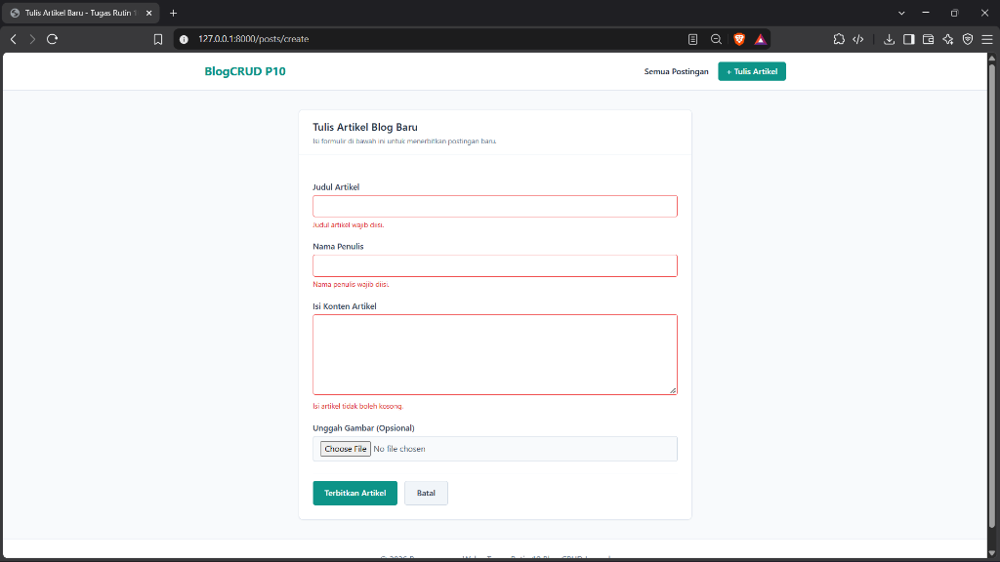
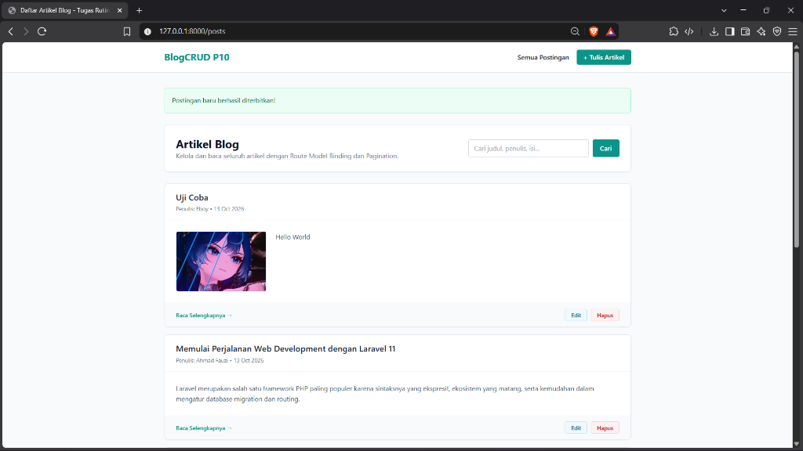
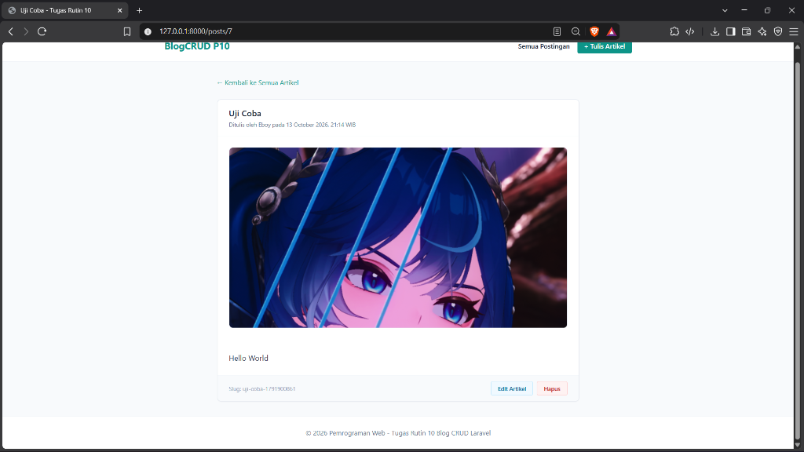
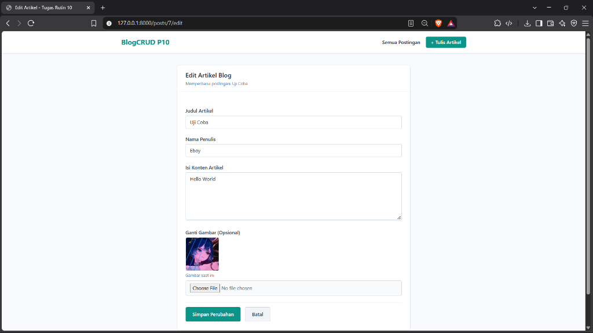
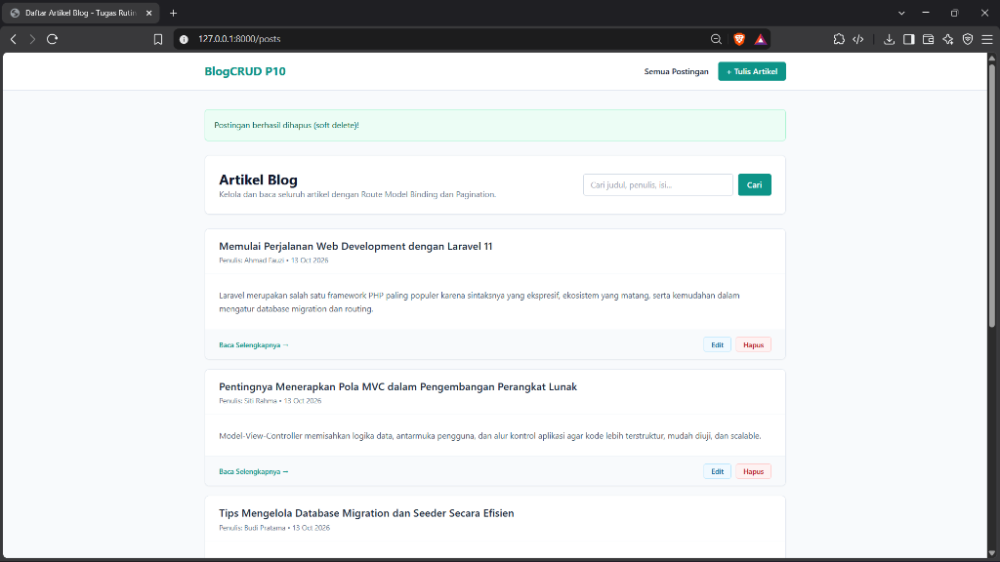

# Mini Blog CMS (Laravel 11)

Aplikasi Content Management System (CMS) sederhana untuk publikasi artikel blog dengan pengelolaan data penuh menggunakan Resource Controller Laravel.

## Fitur Utama

- **Pengelolaan Artikel Lengkap (CRUD)**:
  - Membaca daftar artikel dengan cuplikan konten dan navigasi halaman (pagination).
  - Menulis artikel baru dilengkapi opsi unggah gambar sampul.
  - Memperbarui judul, penulis, isi, serta mengganti gambar artikel.
  - Menghapus artikel yang tidak lagi digunakan.
- **Pencarian Artikel**: Pencarian cepat berdasarkan judul, nama penulis, maupun kata kunci dalam konten artikel.
- **Soft Deletes**: Artikel yang dihapus tidak langsung hilang permanen dari basis data, melainkan ditandai waktu penghapusannya sehingga aman dari kesalahan klik.
- **Komponen Blade**: Pemanfaatan komponen antarmuka yang dapat digunakan berulang kali (`<x-card>` dan `<x-alert>`).
- **Validasi Formulir**: Pengecekan data input secara menyeluruh dengan pesan peringatan interaktif di bawah setiap kolom isian.
- **Keamanan CSRF**: Setiap aksi formulir dilindungi token CSRF serta method spoofing (PUT dan DELETE).

## Tampilan Antarmuka

### 1. Daftar Artikel Blog & Pencarian


### 2. Validasi Formulir (Pesan Galat per Kolom)


### 3. Notifikasi Berhasil Terbit & Unggah Gambar


### 4. Detail Artikel Lengkap (Route Model Binding)


### 5. Formulir Edit Artikel (Pre-filled Data & Gambar)


### 6. Notifikasi Hapus Artikel (Soft Delete)


## Cara Instalasi & Menjalankan

1. Masuk ke direktori:
   ```bash
   cd tr10
   ```

2. Pasang dependensi aplikasi:
   ```bash
   composer install
   ```

3. Buat basis data MySQL bernama `db_p10_blogcrud`.

4. Generate application key:
   ```bash
   php artisan key:generate
   ```

5. Hubungkan penyimpanan berkas publik untuk gambar:
   ```bash
   php artisan storage:link
   ```

6. Jalankan migrasi dan isi data awal:
   ```bash
   php artisan migrate --seed
   ```

7. Jalankan server lokal:
   ```bash
   php artisan serve
   ```

8. Buka browser pada alamat `http://127.0.0.1:8000/posts`.
